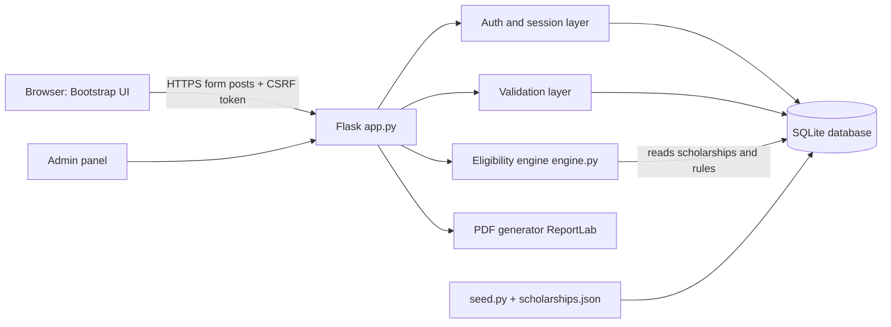
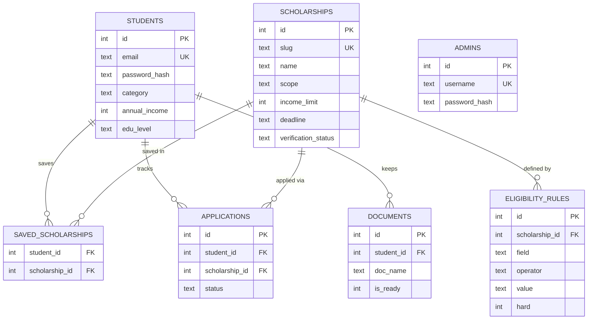
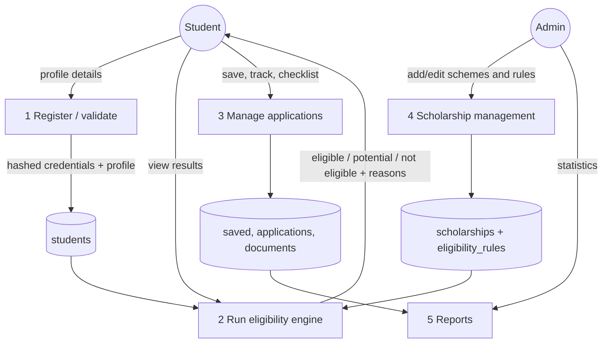

# Scholarship Finder India – Project Documentation

## 1. Problem and objective
Students struggle to find which of the many Central and State schemes they qualify for. This system collects a student's personal,
educational, financial and social details and compares them with the rules of each scheme, reporting where the student stands and why.

## 2. Technology
Python 3 / Flask, SQLite (schema is portable to MySQL, see §9), HTML5, CSS3, JavaScript, Bootstrap 5, Font Awesome, ReportLab (PDF).

## 3. Software architecture

## 4. ER diagram

## 5. Data flow diagram (level 1)

## 6. Eligibility engine
Each scheme has rules `{field, operator, value, hard, message}`. For every rule:
1. missing student data → *verify* (never assumed);
2. rule passes → recorded;
3. hard rule fails → *not eligible* with the rule's message; soft rule fails → *verify*;
4. `manual` rules (e.g. "80th percentile in Class XII board") always require the student to check.

Result: any failure → **Not eligible**; otherwise any open item → **Potentially eligible**; otherwise, only if the scheme is marked
`verified`, → **Eligible**. Unverified schemes can never be labelled Eligible. A passed deadline adds a "window closed" flag but
does not change eligibility. State schemes of other states are hidden rather than listed as "not eligible".

## 7. Test plan and results
`python -m unittest discover -s tests -v` runs 24 tests: engine rules (income, gender, lateral entry, missing data, unverified
schemes, deadlines, other-state hiding) and application behaviour (registration, validation, CSRF, duplicate email, password hashing,
SQL-injection attempt on login, role separation, admin CRUD and rule validation, save/track/documents/PDF/compare, filters,
profile update, account deletion). All 24 passed on 22 Nov 2026.

## 8. Known limitations (be upfront in your viva)
* Seed data covers 12 schemes, not every Central/State scheme. State coverage is Tamil Nadu only; add more via the admin panel after verifying.
* Several schemes are marked "Needs confirmation" (SC/ST/PwD post-matric limits under revision, minority MCM funding cut, NMMSS dates, Tamil Pudhalvan official portal).
* Some benefits (e.g. PM YASASVI post-matric amounts) are not confirmed and display as such.
* The "80th percentile" and "two girls per family" conditions cannot be computed from the form and are flagged for manual check.
* Not tested against MySQL; not load tested; no email verification or password reset; no login rate limiting.
* NSP deadlines for 2026-27 were extended repeatedly for some schemes; always confirm on NSP.

## 9. Moving to MySQL
Replace `sqlite3` in `db.py` with PyMySQL/SQLAlchemy, change `INTEGER PRIMARY KEY AUTOINCREMENT` to `INT AUTO_INCREMENT PRIMARY KEY`,
`INSERT OR IGNORE` to `INSERT IGNORE`, `ON CONFLICT … DO UPDATE` to `ON DUPLICATE KEY UPDATE`, and `?` placeholders to `%s`.

## 10. Future enhancements
More State/UT scheme data with official-source tracking; automatic deadline refresh with admin review queue; email/SMS reminders;
OTP/e-mail verification; Tamil/Hindi UI; document upload with OCR; login throttling and 2FA for admin; REST API; MySQL/PostgreSQL deployment with Docker;
accessibility audit; analytics on missed deadlines.
